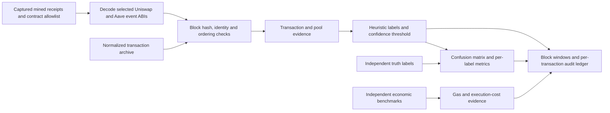
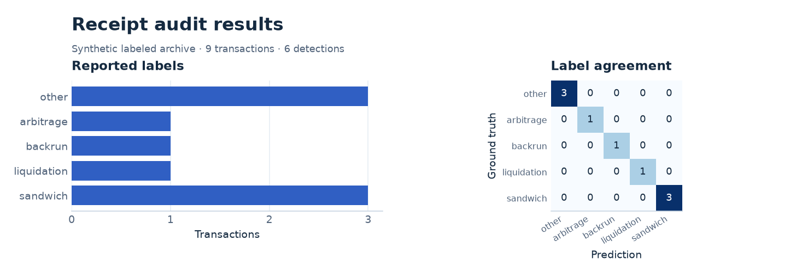

# MEV Detection & Transaction Ordering Research Lab

Audit the ordering and economic evidence of already-mined Ethereum transactions. The lab decodes captured receipts, reports transaction-level heuristic classifications, and compares results with independently supplied labels.

## Run an audit

Requires Python 3.11 or later.

```bash
python -m pip install -e '.[test]'
mev_detection_lab --output reports/demo.json --write-input reports/normalized-demo.json
python -m pytest -q
```

Use a stored receipt bundle or an exported normalized archive for historical investigations.

```bash
mev_detection_lab --receipts data/receipt-bundle.json \
  --truth data/independent-labels.json --economics data/benchmarks.json \
  --window-blocks 20 --min-confidence 0.85 --output reports/archive-audit.json

mev_detection_lab --input reports/normalized-demo.json --output reports/replay.json
```

With the normalized archive, add the label and reference-price files to reproduce scored results. The built-in command supplies synthetic annotations automatically.

## Architecture



| Layer | Contract and behavior |
|---|---|
| `archive.py` | Captures chain ID, block height/hash, transaction index/hash, sender, receipt gas and decoded events. Rejects duplicate order positions and mixed block hashes. |
| `decoder.py` | Decodes logged ERC-20 deltas for allowlisted V3 pools and identifies allowlisted Aave V3 liquidation events. Normalizes token amounts using supplied decimals. |
| `audit.py` | Reconstructs mined order, evaluates matching evidence, records suppressed labels and summarizes block windows. |
| `cli.py` | Loads annotations separately, stores source provenance and writes normalized archive and audit JSON. |

## Evidence and scoring

| Reported label | Observed evidence |
|---|---|
| `liquidation` | A decoded Aave V3 `LiquidationCall` in the mined receipt. |
| `arbitrage` | A continuous closed token path across multiple pool events within one mined transaction. |
| `backrun` | A closed path involving a pool also used by the preceding transaction from a different sender. |
| `sandwich` | Related pre-trade, middle and post-trade swaps within the same pool, with same-sender outer legs and observed direction reversal. |
| `other` | Evidence falls outside the supported patterns or below the configured confidence threshold. |

Heuristic labels are candidates for retrospective review. The output records the triggering rule, the pre-filter label and the scored result. Provide independent JSON rows of the form `{"tx_hash":"0x…","label":"other"}` to score coverage, precision, recall, F1, and false-positive and false-negative counts. Metrics use only annotated transactions. Rule confidence is a fixed heuristic score.

## Receipt and economics inputs

- A receipt bundle contains `chain_id`, `receipts` (the result objects from `eth_getTransactionReceipt`), `uniswap_v3_pools`, `aave_v3_pools` and optional `native_usd_by_block`.
- Each Uniswap entry has `address`, `token0`, `token1`, `decimals0` and `decimals1`. Each Aave entry is a permitted Pool proxy address.
- Gas in the native token uses receipt `gasUsed × effectiveGasPrice`. USD gas requires a block-specific native USD mark. Any additional L2 publication cost requires separate accounting.
- An economics row can supply `gross_extraction_usd` and optionally `reference_price_usd`, `executed_price_usd`, and `side`. The report deducts observed gas when both values exist and computes signed execution shortfall against the supplied benchmark. Keep the benchmark source with the capture.

A real Ethereum receipt captured at block 26,486,702 was decoded and audited through the archive path. External receipts for a study should cover all relevant transactions in each block, with separately audited labels and benchmarks.

[Ethereum receipt fields](https://ethereum.org/developers/docs/apis/json-rpc/#eth_gettransactionreceipt) · [Uniswap V3 event source](https://github.com/Uniswap/v3-core/blob/main/contracts/interfaces/pool/IUniswapV3PoolEvents.sol) · [Aave V3 Pool interface](https://aave.com/docs/aave-v3/smart-contracts/pool)

## Reproduced demo results

The nine-transaction synthetic archive exercises six positive detections and three controls with independent fixture labels. Detection quality on an external archive depends on available receipts, the address allowlist, and the labeling policy.



## Commit dates

Both Git date fields on the 40 commits in the November 2026 portfolio update
use retrospectively assigned milestones from 2026-07-01 through 2026-08-31,
the project period listed in the résumé. Each commit records its assigned date
in the Project-Milestone trailer and its original committer timestamp in
the Original-Commit-Date trailer. Use git log --format=fuller to inspect the dates.

## Coverage-aware audits

Supply independently verified total transaction counts in
`transaction_counts_by_block` to distinguish complete and partial block captures.
`--require-complete-blocks` excludes ordering labels when coverage is partial or
unknown. Direct protocol event labels remain visible. Per-row reasons explain
whether the confidence floor or capture coverage suppressed an ordering label.

Use `--ledger-csv` for a tabular audit and `--write-input`, `--write-truth`, and
`--write-economics` to save separate replay inputs. Reports record the source
fingerprints of supplied captures and annotations. ABI-derived integer token amounts and gas
charges travel as strings to preserve precision.
