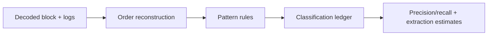

# MEV Detection & Transaction Ordering Research Lab

A block-level research harness that reconstructs transaction order and applies transparent rules for arbitrage, liquidation, backrunning, and sandwich patterns. Synthetic blocks make the evaluation reproducible and safe to run offline.

## Architecture


## Structural overview
`src/mev_lab/detect.py` contains normalized transaction records, pattern classification, fixtures, and evaluation; `cli.py` prints a compact detection run; `tests/` covers labeled patterns.

## Workflow
1. Decode transactions into a stable `(block,index)` order.
2. Join neighboring swaps and sender/victim relationships.
3. Emit an auditable classification with the triggering rule.
4. Compare labels against a fixture truth set.

## Design rationale
Rules are explicit before any ML is introduced. This makes false positives inspectable and provides a labeled corpus for future models. Production adapters should preserve raw hashes and event topics alongside normalized fields.

## Run
```bash
pip install -e .
python -m mev_lab.cli
pytest -q
```

## Live adapter boundary
`mev_lab.rpc.JsonRpcClient` can fetch Ethereum-family logs for a block-range adapter; classification accepts normalized transactions so decoding remains a replaceable boundary.

### Credential-dependent blockers
Live MEV research requires an archive-capable RPC and calldata/event decoders. Public endpoints may prune historical traces or rate-limit block scans.

## Environment

Copy `.env.example` and set `RPC_URL` only when a reachable provider is available. The adapters do not embed credentials and never run implicitly during tests.

## Limitations
The fixture does not model private mempools, builder policies, or multi-hop calldata semantics. Classification is research evidence, not an accusation of malicious behavior.
